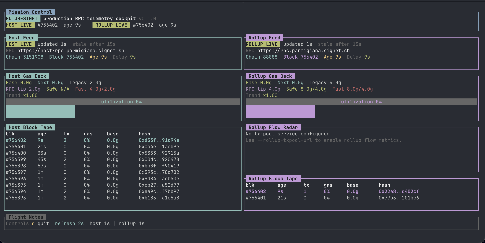

# FutureSight

FutureSight is a Rust terminal dashboard for monitoring Ethereum RPC health, recent block flow, fee pressure, and optional tx-pool activity across a host chain and a rollup.

 



## What It Shows

### Dashboard Tab

- Connection state with stale and error signaling
- Current chain ID and best observed chain height
- Rollup tip sync status against the host tip, including block difference when out of sync and a red rollup feed box when unsynced
- Block age and chain halt alerts
- EIP-1559 fee telemetry, fee suggestions, utilization gauge, and fee trend sparkline
- Rolling block tape with gas usage and base fee context
- Rollup builder tracking: per-block builder address in the block tape, plus a builder breakdown panel showing block count and share percentage per builder
- Optional tx-pool service health, cache counts, and recent transactions in the rollup panel

### Events Tab

- On-chain event log sourced from Signet system contracts (Zenith, Orders, Passage, Transactor)
- Events from both host and rollup chains merged newest-first
- Classified event types: BlockSubmitted, SequencerSet, Enter/Exit, Order/Filled, Sweep, Transact, Withdrawal, and more
- Scrollable with `j`/`k`/`↑`/`↓` and `PageUp`/`PageDown`

## Build

Prerequisites: Rust toolchain. `make` is optional and only needed for the helper targets below.

```bash
git clone https://github.com/dylanlott/futuresight
cd futuresight
cargo build --release
```

## Run

The built-in CLI defaults target the Parmigiana Signet environment.

```bash
cargo run
```

Show the full CLI surface:

```bash
cargo run -- --help
```

Tune refresh rate and history depth:

```bash
cargo run -- \
  --refresh-interval 3 \
  --max-block-history 40 \
  --block-delay-secs 90
```

Enable tx-pool telemetry:

```bash
cargo run -- \
  --txpool-url https://transactions.parmigiana.signet.sh
```

Disable tx-pool transaction lists while keeping tx-pool summary counts:

```bash
cargo run -- \
  --txpool-url https://transactions.parmigiana.signet.sh \
  --no-txpool-list
```

Use the Makefile wrappers:

```bash
make run
make dev
make parmigiana
make gouda
make mainnet
```

Notes:

- `cargo run` uses the CLI defaults shown in the table below.
- `make run` falls back to the same Parmigiana endpoint defaults as the CLI, but existing shell env vars or `make` variable overrides still win.
- `make parmigiana` forces `HOST_RPC_URL=https://host-rpc.parmigiana.signet.sh` and `ROLLUP_RPC_URL=https://rpc.parmigiana.signet.sh`.
- `make gouda` runs the gouda rollup against the parmigiana host: `HOST_RPC_URL=https://host-rpc.parmigiana.signet.sh`, `ROLLUP_RPC_URL=https://rpc.gouda.signet.sh`, `TXPOOL_URL=https://transactions.gouda.signet.sh`. Gouda reuses the Parmigiana host chain (chain id `3151908`); the host-contract watch list resolves to Parmigiana's contracts by default.
- `make mainnet` forces `HOST_RPC_URL=https://rpc.flashbots.net` and `ROLLUP_RPC_URL=https://rpc.mainnet.signet.sh`.
- `make run RUN_ARGS="--no-txpool-list"` is the Makefile path for flags that do not have env-var equivalents.

## Configuration

Most runtime flags can also be set through environment variables.

Flag                       | Env                 | Default
-------------------------- | ------------------- | -------------------------------------------
`--host-rpc-url`           | `HOST_RPC_URL`      | `https://host-rpc.parmigiana.signet.sh`
`--rollup-rpc-url`         | `ROLLUP_RPC_URL`    | `https://rpc.parmigiana.signet.sh`
`--txpool-url`             | `TXPOOL_URL`        | `https://transactions.parmigiana.signet.sh`
`--block-delay-secs`       | `BLOCK_DELAY_SECS`  | `60`
`--refresh-interval`, `-r` | `REFRESH_INTERVAL`  | `2`
`--max-block-history`      | `MAX_BLOCK_HISTORY` | `24`
`--txpool-max-rows`        | `TXPOOL_MAX_ROWS`   | `12`
`--no-txpool-list`         | none                | `false`

Notes:

- `--txpool-url` powers the rollup panel's Flow Radar section.
- `--txpool-url` is a network-level tx-pool endpoint. For known Parmigiana and mainnet hosts, FutureSight auto-populates the watched host system contracts from Signet constants instead of taking a manual contract list.
- `--no-txpool-list` disables fetching transaction rows while keeping tx-pool summary requests enabled.

### Compile-Time Constants

Additional tuning knobs live in `src/config.rs`. These are not exposed as CLI flags but can be adjusted before building.

Constant                    | Default | Description
--------------------------- | ------- | -------------------------------------------
`STALE_AFTER`               | `15s`   | Duration without a successful update before status flips to Stale
`MAX_BACKFILL_PER_CYCLE`    | `12`    | Maximum missing blocks fetched per refresh cycle
`RPC_TIMEOUT_SECS`          | `6`     | HTTP timeout for JSON-RPC calls
`TXPOOL_TIMEOUT_SECS`       | `4`     | HTTP timeout for tx-pool requests
`FEE_HISTORY_BLOCKS`        | `24`    | Number of blocks requested in `eth_feeHistory`
`FEE_HISTORY_PERCENTILES`   | `[10, 25, 50, 75, 90]` | Reward percentiles for fee suggestions
`SUGGESTION_RAMP_FACTOR`    | `2.0`   | Headroom multiplier for maxFee suggestion
`GAS_ALERT_HIGH_GWEI`       | `100`   | Base fee threshold (Gwei) for red highlighting
`GAS_SPIKE_MULTIPLIER`      | `2.0`   | Base fee vs moving average ratio for spike detection
`EVENT_LOG_MAX_ENTRIES`      | `500`   | Maximum system events retained in memory per chain
`EVENT_LOG_LOOKBACK_BLOCKS`  | `50`    | Initial lookback depth (in blocks) when the event log first connects

### Builder Name Registry

Builder addresses are resolved to human-readable names via a static lookup table in `src/data.rs`. To register known builders, add entries to the `KNOWN_BUILDERS` const:

```rust
use alloy::primitives::address;

const KNOWN_BUILDERS: &[(Address, &str)] = &[
    (address!("abcd...1234"), "Builder Name"),
];
```

Unknown builders are displayed as truncated addresses (e.g., `0xabcd..1234`).

## Controls

Key              | Action
---------------- | -------------------------------------------
`q` / `Esc`      | Quit
`Tab`            | Switch between Dashboard and Events tabs
`f`              | Toggle host contract filter on/off
`↑` / `k`       | Scroll up (Events tab)
`↓` / `j`       | Scroll down (Events tab)
`PageUp`         | Scroll up 20 rows (Events tab)
`PageDown`       | Scroll down 20 rows (Events tab)

## Make Targets

```bash
make build
make clean
make dev
make fmt
make help
make lint
make mainnet
make parmigiana
make release
make run
make test
make watch
```

`make dev` is an alias for `make watch`. `make watch` requires `cargo-watch`.
